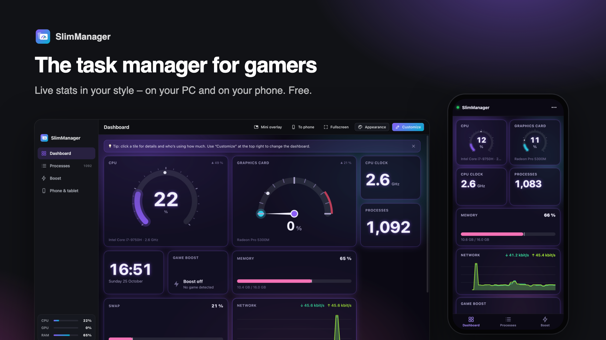

# SlimClick – your phone as a presentation remote

**Scan a QR code and control PowerPoint, Keynote, Google Slides or PDF from your phone. No app install on the phone.**
Free · no ads · no account · works on school Wi-Fi (via phone hotspot) · only your phone can control it.

⬇️ **[Download SlimClick](https://slimbitapps.github.io/SlimClick/)** · by [SlimBit Apps](https://slimbitapps.github.io/)



## Why SlimClick?

- **No app on the phone** – the camera scans the QR code, a web page opens. Works with any iPhone or Android.
- **Every presentation program** – SlimClick presses the same keys as a real clicker: PowerPoint, Keynote, Google Slides, LibreOffice, Canva, PDF.
- **Laser pointer & spotlight** – touch the slide preview on your phone; the red dot appears exactly there on the projector.
- **Slide preview on the phone** – see what the audience sees, even when you face them.
- **Timer with a silent warning** – the phone screen flashes 5, 2 and 1 minute before the end.
- **Go to slide, black screen, start/end presentation** – all on the phone.
- **Secure** – one-time key in the QR code (never sent over the network), every command signed, extra devices need your approval.
- **School Wi-Fi** – built-in step-by-step hotspot guide; the QR code updates by itself when the network changes.
- English, German, French, Spanish, Italian · light & dark theme · simple and pro mode.

<p>
  
  
</p>

## Install

- **Windows 10/11:** download `SlimClick-Setup.exe` and double-click it. No admin rights? Use `SlimClick-Windows-portable.zip`.
- **Mac (macOS 12+):** open `SlimClick-Mac.dmg` (Intel: `SlimClick-Mac-Intel.dmg`) and drag SlimClick into Applications.

---

# SlimClick (Deutsch)

Dein Handy als Präsentations-Fernbedienung – für Windows und Mac. QR-Code scannen und los.

**Alles bleibt lokal.** Keine Datensammlung, kein Konto, kein Internet nötig.

## Installieren

**Am einfachsten über die [Download-Seite](https://slimbitapps.github.io/SlimClick/)**: Sie erkennt dein System und erklärt die Installation.

- **Windows:** `SlimClick-Setup.exe` doppelklicken. Beim ersten Start fragt die Firewall → **„Zugriff zulassen“**.
- **Mac:** `SlimClick-Mac.dmg` öffnen, Symbol auf „Programme“ ziehen. Die App führt dich durch zwei Erlaubnisse
  (**Bedienungshilfen** = Pflicht, **Bildschirmaufnahme** = für die Vorschau).

## So funktioniert's

Beim ersten Start: **Sprache**, **Aussehen**, **Bedienung** (Einfach/Profi), am Mac die **Erlaubnisse**, dann eine kurze Anleitung.

1. **QR-Code scannen** – mit der normalen Kamera-App. Es öffnet sich eine Webseite.
2. **Präsentation starten** – PowerPoint, Keynote, Google Slides oder PDF im Vollbild. Einmal ins Fenster klicken.
3. **Am Handy „Weiter“ tippen.**

| Am Handy | Wirkung |
|---|---|
| Weiter / Zurück (oder auf der Vorschau wischen) | Nächste / vorige Folie |
| Laser | Auf die Vorschau tippen → roter Punkt auf dem Beamer |
| Spotlight | Nur eine Stelle bleibt hell |
| Schwarz | Bildschirm schwarz (nochmal = zurück) |
| Gehe zu | Foliennummer eintippen |
| Timer | Countdown oder Stoppuhr, Bildschirm blinkt bei 5/2/1 Min. und am Ende |
| ⋯ Mehr | Präsentation starten (PowerPoint, Keynote, Google Slides, PDF), beenden, erste/letzte Folie, weiß, Linkshänder-Modus |

**Ausprobieren ohne PowerPoint:** In der App „Testfolien öffnen“.

## Schul-WLAN

Viele Schul- und Firmen-WLANs trennen Geräte voneinander. Dann: **Hotspot am Handy einschalten → Laptop damit
verbinden → QR-Code neu scannen.** Die App erkennt den Wechsel selbst und zeigt eine Anleitung (oben „Hotspot-Anleitung“).
Meldet sich 40 Sekunden lang kein Handy, schlägt die App das von selbst vor.

## Sicherheit

- Der QR-Code enthält einen **geheimen Einmal-Schlüssel** im `#`-Teil der Adresse – der wird vom Browser **nie übers WLAN gesendet**.
- Daraus leiten Handy und Laptop einen **Geräte-Schlüssel** ab (wird ebenfalls nie übertragen). Danach ist der QR-Code ungültig.
- **Jeder Befehl ist signiert und nummeriert** (HMAC-SHA256) → nichts fälschbar, nichts wiederholbar.
- Ist schon ein Handy verbunden, muss jedes weitere **am Laptop zugelassen** werden.
- Nur Geräte aus dem **lokalen Netz**, nur IP-Adressen als Host (Schutz vor DNS-Rebinding), Sperre nach 5 Fehlversuchen.
- Gekoppelte Geräte siehst und entfernst du unter **Einstellungen → Sicherheit**.

---

## Stand der Entwicklung

**Version 1.0** – Weiter/Zurück, Wischen, Gehe zu, Schwarz/Weiß, Präsentation starten/beenden, Laserpointer & Spotlight,
Folienvorschau, Timer (Countdown/Stoppuhr, Aufblitzen als Warnung), sichere Kopplung, Zustimmung für weitere Geräte,
Hotspot-Anleitung, Testfolien, Querformat, Linkshänder-Modus, Laptop wach halten, 5 Sprachen, hell/dunkel, Einfach/Profi.

**Als Nächstes (Version 2):** Sprechernotizen aus der PowerPoint-Datei – siehe [docs/PLAN.md](docs/PLAN.md).

Veröffentlichen & bekannt machen: [docs/VEROEFFENTLICHEN.md](docs/VEROEFFENTLICHEN.md) · Texte für Portale: [docs/STORE-TEXTE.md](docs/STORE-TEXTE.md)

---

## Für Entwickler

Technik: Electron (Fenster, Server, Tastendrücke), React + TypeScript (Laptop-Oberfläche), Vite (Bauen).
Die Handy-Seite ist bewusst ohne Framework (lädt sofort).

```bash
npm install
npm start            # App bauen und starten
npm test             # Sicherheits- und Logiktests
npm run test:e2e     # echte App automatisch durchklicken (inkl. Handy-Fenster, Screenshots)
npm run icons        # Logo und Symbole neu erzeugen
npm run dist:win     # Windows-Installer (auf Windows)
npm run dist:mac     # Mac-DMG (auf einem Mac)
```

Aufbau:
- `electron/core/` – Logik ohne Oberfläche: Server (`server.cjs`), Kopplung (`auth.cjs`), Tastendrücke (`keys.cjs`),
  Netzwerk-Auswahl (`network.cjs`), Timer, Einstellungen
- `electron/main.cjs` – Fenster, Laserpointer-Ebene, Folienvorschau, Verbindung zur Oberfläche
- `src/` – Laptop-Oberfläche (React); Texte in `src/locales/`
- `src/remote/` – Handy-Seite · `src/overlay/` – Laserpunkt · `src/demo/` – Testfolien · `src/shared/hmac.ts` – Signatur
- `test/` – automatische Tests · `brand/` – Logo · `website/` – Download-Seite

Installer werden per GitHub Actions automatisch gebaut (`.github/workflows/build.yml`) – nur bei Code-Änderungen,
nicht bei Texten, Bildern oder der Website.
